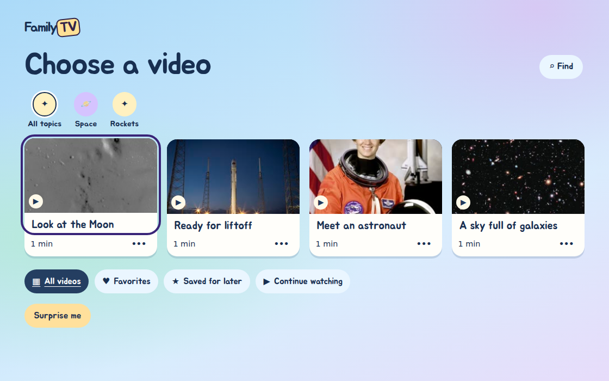
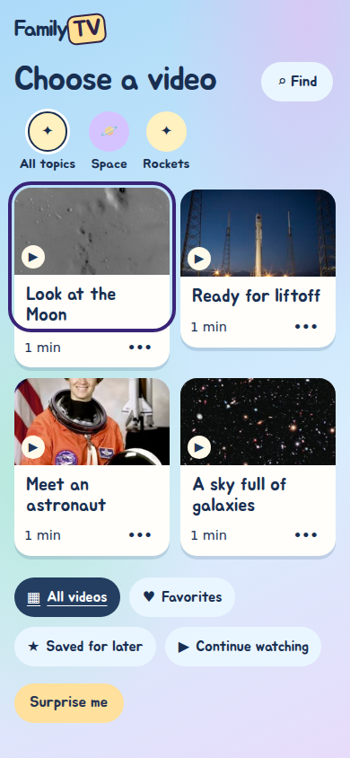

# Set up FamilyTV

FamilyTV runs on your server. You manage it from a browser on your phone or computer, and your child watches in a browser or the Android app. GitHub Pages hosts this guide. Your dashboard, videos and profiles stay on your server.

<nav class="jump" aria-label="Guide sections">
<a href="#install-on-your-server">Install</a>
<a href="#share-a-plex-folder">Share a Plex folder</a>
<a href="#approve-a-video">Approve a video</a>
<a href="#connect-your-phone-and-tv">Pair your TV</a>
<a href="#test-a-session">Test a session</a>
<a href="#if-setup-gets-stuck">Troubleshooting</a>
</nav>

## Install on your server

You'll need Git, Docker with the Compose plugin, and a video you can play locally. One short captioned episode is enough for the first test. Run these commands on the server:

```sh
git clone https://github.com/JPLuker/FamilyTV.git
cd FamilyTV
docker compose version
```

If you've already cloned FamilyTV, open that folder. Run the remaining Compose commands there.

## Share a Plex folder

Use the folder path on the server. If Plex maps `/mnt/media/TV:/tv`, FamilyTV needs `/mnt/media/TV`. To look up the path, use this command with jq and your Plex container's name. The left side of each line is the host path.

```sh
docker inspect plex | jq -r '.[0].Mounts[] | "\(.Source) -> \(.Destination)"'
```

Open or create `.env` beside `compose.yaml`. Add this line, replacing the example with your folder. Keep any settings already in the file.

```dotenv
FAMILYTV_MEDIA_ROOT="/mnt/media/TV"
```

FamilyTV reads this folder through a read-only mount. Importing creates a catalog entry. Plex keeps using the same file. After installation, open **Media library → Choose folder** in the parent dashboard. Browse to a folder and choose **Use this folder and scan**. FamilyTV remembers the selection for future scans and keeps existing imports and approvals. For example, put `Forest.vtt` beside `Forest.mp4`.

### If another app uses port 8080

The default address is `127.0.0.1:8080`. If qBittorrent or another service already uses that port, choose a free one. With Compose 2.24.4 or newer, create or edit `compose.override.yaml` beside `compose.yaml` and set the API port:

```yaml
services:
  api:
    ports: !override
      - "127.0.0.1:18080:8080"
```

Use your chosen host port in the dashboard URL, SSH tunnel and reverse proxy below. The examples use the default port.

### Start FamilyTV

```sh
docker compose up -d --build
docker compose ps
curl -fsS http://127.0.0.1:8080/api/health
```

The health response should include `"status":"ok"`. Compose runs the FamilyTV web app and API together, plus a PostgreSQL container for household data.

## Approve a video

On the server, open `http://127.0.0.1:8080`. If the server has no desktop, run the following on your laptop. Replace `user@server` with your SSH login, keep the connection open, then visit `http://127.0.0.1:18081` on the laptop.

```sh
ssh -L 18081:127.0.0.1:8080 user@server
```

1. Create the parent account and sign in. Create a child profile.
2. Under **Media library**, choose **Scan now**. The server imports the whole mounted folder and its subfolders, skips duplicates and checks hourly for additions.
3. For a reviewed batch, open **Approval queue and library coverage**, choose the child, select matching videos and choose **Approve selected**. For an individual file, choose **Preview** to check it. Open **Review**, check the child under **Approved for**, then choose **Save review**. If the profile requires captions or described audio, verify those settings in the review too.

You can now test in a browser. Under **Household devices**, choose **Get pairing code**. Paste the one-time viewer link into a separate browser profile or private window on the same computer. Opening it in your parent browser signs that browser out. The paired screen waits until you start a viewing session.

## Connect your phone and TV

Complete parent setup first. The default address only works from the server. For a TV, use an HTTPS address on your home network that both the phone and TV can reach, with a certificate both devices trust.

If you already run an HTTPS reverse proxy on the server host, give FamilyTV its own hostname and point it at `127.0.0.1:8080`. Preserve the Host header. A proxy running in a separate container has its own loopback address, so that target only works for a proxy using the host network. Configure your household DNS and certificate for the hostname you choose. [Example Caddy configuration](https://github.com/JPLuker/FamilyTV/blob/main/SECURITY.md#https-on-the-household-network).

Add `FAMILYTV_SECURE_COOKIES=true` to the same `.env` file and run:

```sh
docker compose up -d api
```

Open your HTTPS address on your phone and sign in. Keep this development build on your household network.

For a LukerPlus debug test, connect to the same trusted Wi-Fi and enter `http://192.168.86.163:8095`. HTTP testing requires the server’s local HTTP cookie setting (Compose defaults to `FAMILYTV_SECURE_COOKIES=false`). Keep secure cookies enabled on production HTTPS deployments.

1. Install the APK from the Android device test issue. Download the ZIP, extract it and sideload the APK onto your Android device. On phones and tablets open FamilyTV from the app drawer and enter the server address and the six-character code from the parent dashboard. [APK and device checklist](https://github.com/JPLuker/FamilyTV/issues/1).
2. On the TV, enter your FamilyTV HTTPS address. Choose **Pair using a phone** and scan the QR code with your phone.
3. On the phone, open **Household devices**. Match the eight characters shown on the TV, then confirm the screen. Choose **Open paired viewer** on the TV.
4. To pair with the remote instead, choose **Household devices → Get pairing code** on your phone and enter the six-character code on the TV. The code expires after ten minutes. Once paired, assign a child with the screen’s **Viewing profile** menu, then use **Session** to control viewing. The device stays linked across sessions. Choose **Disconnect all devices** to revoke the household’s device credentials.

## Test a session

The quick bar sits above the choices. Children get up to 12 eligible videos strung together in two rows. Swipe sideways or use the arrows to see the rest of the session’s choices. A new session can bring different videos onto the board. If you want a child’s next play to start where they stopped, enable **Resume a video from its saved position** in the parent profile settings. It starts off.

Videos appear under the subjects you entered in Review. On a video, open **•••** and choose **Save for later** to put it aside. It leaves this board and gets priority in the next session it fits. Finishing it clears the save.

Use the remote to choose the approved episode and press **OK** to play. Check the audio and captions. Use Back to return to the episode, then to the list. Start playback again and choose **End now** on your phone. The TV should return to the session ending.

For the cutoff test, start a fresh session and choose **Finish by a clock time**. Leave enough time for the whole clip or it won't appear in the list. Start the clip and pause before the deadline. Check that the TV locks when time runs out.

## If setup gets stuck

| What you see | What to check |
| --- | --- |
| The server won't start | Run `docker compose logs --tail=50 api db`. If the port is in use, change the host port above. |
| The scan finds no files | Run `docker compose exec api ls -la /media`. Check the host path in `.env`, the container's read access and the file type. FamilyTV accepts MP4, MKV and WebM. Run `docker compose up -d api` after changing the path. |
| You can preview an episode but the child can't see it | Check **Approved for**, the profile's accessibility requirements and how much session time is left. |
| The dashboard works on the server but the TV can't connect | Open the same HTTPS address on your phone over Wi-Fi. Check household DNS, the certificate and the proxy's upstream port. |
| The pairing code expired | Open **Household devices** and get a fresh code. |

PostgreSQL stores your child profiles, approvals and session settings. Keep a separate backup of the video files. [Back up or restore the household database](https://github.com/JPLuker/FamilyTV/blob/main/docs/BACKUPS.md).

## Screenshots

These screens show a test profile with 12 approved sample clips. Download an individual PNG or save all three together.

<div class="shots">
<figure><figcaption><a href="../downloads/viewer-preview.png" download="familytv-viewer.png">Child viewer PNG</a></figcaption></figure>
<figure><figcaption><a href="../downloads/phone-preview.png" download="familytv-phone.png">Phone view PNG</a></figcaption></figure>
<figure><figcaption><a href="../downloads/ending-preview.png" download="familytv-ending.png">Ending screen PNG</a></figcaption></figure>
</div>

<a class="download" href="../downloads/familytv-screenshots.zip" download>Download all screenshots (ZIP)</a>

### Android setup and playback

The app searches for FamilyTV at setup. The debug build checks the configured LukerPlus address automatically. Other installations can advertise their HTTPS origin using DNS-SD: on the LAN host with Avahi running, copy `deploy/familytv.service` to `/etc/avahi/services/` after editing the port and origin to match the address trusted by your devices. Manual entry is under **Advanced server address**.

Choose **Parent mode** to open the authenticated dashboard in the device browser. Set the parent PIN under **Parent sign-in settings**. Before generating a device code or authorizing a TV, optionally allow that screen to start a one-video session. Assign a viewing profile after linking. Each viewer-initiated start requires the parent PIN and respects the assigned profile's viewing windows and allowances. In parent mode the dashboard can start sessions for other profiles and their assigned devices.

Tap a tile or press OK to play. The tile’s menu holds Save for later. The player returns to choices when the video finishes. During import and scan, FamilyTV fills category and subject from available local sidecar categories, genres and recognized topic metadata. Review still controls approval.
